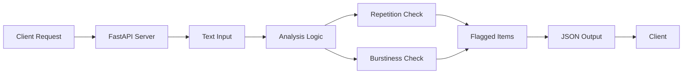

# Veriscript

Transform AI-generated text into human-sounding content to avoid detection

# Text Analyzer MVP

A simple tool to analyze text for AI-like patterns.

## Installation

pip install -r requirements.txt

## Usage

python main.py

## Tests

pytest -q

## Architecture

Mermaid source

